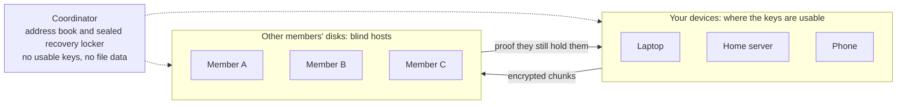

# ITSaNAS

**A peer-to-peer cloud where people trade disk space, and hosting someone's data
gives you no way to read it.**

You pledge some of your disk and bandwidth. Other members do the same. Your files
live encrypted on their machines, theirs live encrypted on yours, and nobody can
open anybody else's.

> ⚠️ **Under construction. Do not put data you care about in this.** It is a working
> prototype built in the open, run so far by one person on a handful of machines.
> Keep another copy of anything you store with it.

<!-- GENERATED:stats -->
**1457 tests, 474 of them red-team** (a red-team test passes when the attack fails) · **10/16 milestones done**
<!-- /GENERATED:stats -->

## The picture

Three things have to hold at once: a host cannot read what it stores, your devices
are often offline, and you can recover on a fresh machine from a passphrase alone.
[How it works](How-it-works) walks one file through all three.

## Where to go

| If you want to... | Go to |
| --- | --- |
| See what is built and what is not | [Roadmap](Roadmap) |
| Understand the mechanism | [How it works](How-it-works) |
| Try it | [FIRST-STEPS](https://github.com/SigSegGit/itsanas/blob/main/FIRST-STEPS.md) |
| Read the design and the arguments | [DESIGN](https://github.com/SigSegGit/itsanas/blob/main/docs/DESIGN.md) |
| Know what a member gives and gets | [ECONOMICS](https://github.com/SigSegGit/itsanas/blob/main/docs/ECONOMICS.md) |
| Follow the work | the [project board](https://github.com/SigSegGit/itsanas/projects) |

Licence: AGPL-3.0. Source: [SigSegGit/itsanas](https://github.com/SigSegGit/itsanas).
