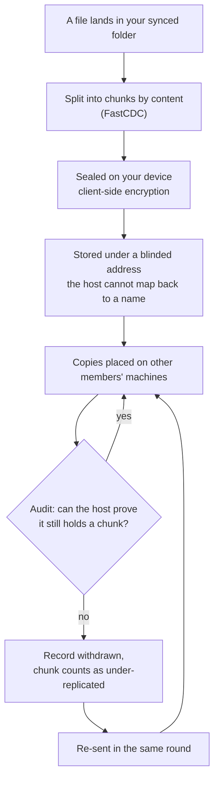
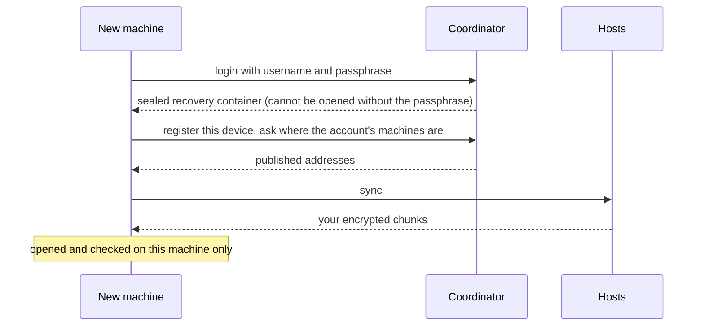
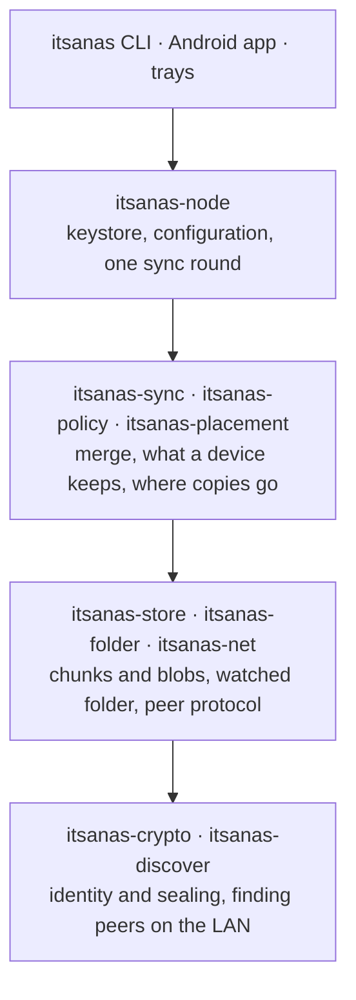

# How it works

One file, from your disk to other people's disks and back. The full version, with
every constant, is [ARCHITECTURE](https://github.com/SigSegGit/itsanas/blob/main/docs/ARCHITECTURE.md);
this page is the shape.

## The life of a file

The audit draws chunks in an order the host cannot predict. That unpredictability
is the whole mechanism, and it took three attempts to get right; the story is in
[ROADMAP](https://github.com/SigSegGit/itsanas/blob/main/docs/ROADMAP.md).

## Getting your data back on a new machine

This was run on the real fleet with the writing machine switched off: the files
came back byte for byte. The evidence is in
[MVP](https://github.com/SigSegGit/itsanas/blob/main/docs/MVP.md) section 6, test D.

## Layers

Every arrow points down: no lower layer knows about a higher one, and
`itsanas-crypto` depends on nothing else in the project, which is what makes it
auditable alone.

Back to [Home](Home) · [Roadmap](Roadmap).
