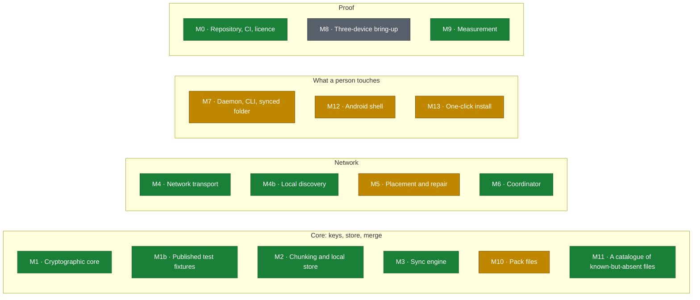

# Roadmap

Everything on this page that is a status is **redrawn from
[ROADMAP.md](https://github.com/SigSegGit/itsanas/blob/main/docs/ROADMAP.md) and
[MVP.md](https://github.com/SigSegGit/itsanas/blob/main/docs/MVP.md)** by
`scripts/check-wiki.py`, and CI refuses a change to those files that leaves this
page behind. To change a status, change it there.

<!-- GENERATED:stats -->
**1461 tests, 478 of them red-team** (a red-team test passes when the attack fails) · **10/16 milestones done**
<!-- /GENERATED:stats -->

## Progress

<!-- GENERATED:progress -->
🟩🟩🟩🟩🟩🟩🟩🟨🟩🟨⬜🟩🟨🟩🟨🟨

**10 of 16 milestones done**, 5 in progress, 1 not started. One square per milestone, in order.
<!-- /GENERATED:progress -->

## Map

<!-- GENERATED:map -->

Green is done, amber is in progress, grey is not started. Grouping follows the layers in [ARCHITECTURE](https://github.com/SigSegGit/itsanas/blob/main/docs/ARCHITECTURE.md); it says where a milestone sits, not what depends on what.
<!-- /GENERATED:map -->

## Milestones

<!-- GENERATED:table -->
| | Milestone | Where | Status |
| --- | --- | --- | --- |
| 🟩 | **M0** Repository, CI, licence | — | Done |
| 🟩 | **M1** Cryptographic core | `itsanas-crypto` | Done |
| 🟩 | **M1b** Published test fixtures | `itsanas-testkit` | Done |
| 🟩 | **M2** Chunking and local store | `itsanas-store` | Done |
| 🟩 | **M3** Sync engine | `itsanas-sync` | Done |
| 🟩 | **M4** Network transport | `itsanas-wire`, `itsanas-tls`, `itsanas-net` | Done |
| 🟩 | **M4b** Local discovery | `itsanas-discover` | Done |
| 🟨 | **M5** Placement and repair | `itsanas-placement` | In progress |
| 🟩 | **M6** Coordinator | `itsanas-coord`, `itsanas-coordinator` | Done |
| 🟨 | **M7** Daemon, CLI, synced folder | `itsanas-cli`, `itsanas-folder` | In progress |
| ⬜ | **M8** Three-device bring-up | — | Not started |
| 🟩 | **M9** Measurement | `itsanas bench` | Done |
| 🟨 | **M10** Pack files | `itsanas-store` | In progress |
| 🟩 | **M11** A catalogue of known-but-absent files | `itsanas-store` | Done |
| 🟨 | **M12** Android shell | `android/`, `crates/itsanas-android` | In progress |
| 🟨 | **M13** One-click install | `install/` | In progress |

What each status means in detail, with the dates and the hardware it was watched on, is in [ROADMAP.md](https://github.com/SigSegGit/itsanas/blob/main/docs/ROADMAP.md).
<!-- /GENERATED:table -->

## When is it a product? The acceptance tests

The verdict on the MVP is tests A to M and O passing unassisted on the fleet; N (the
filenames real people have) is on the list but does not block it. The fleet is a
Windows laptop, a Raspberry Pi, virtual machines, and a Mac in another house, described
in [MVP.md](https://github.com/SigSegGit/itsanas/blob/main/docs/MVP.md) section 2. This
is where each test stands.

<!-- GENERATED:acceptance -->
A🟨 B🟨 C🟩 D🟩 E🟩 F🟦 G🟦 H🟨 I🟦 J🟨 K❔ L❔ M❔ N❔ O🟨

| | Test | Verdict recorded in MVP.md §6 |
| --- | --- | --- |
| 🟨 | **A** Install and enrol, without editing a file by hand | In progress |
| 🟨 | **B** A file appears | In progress |
| 🟩 | **C** Blind hosting, verified rather than promised | Done: on two real machines |
| 🟩 | **D** Recovery from nothing | Done: by passphrase alone, on the fleet, 2026-09-21 |
| 🟩 | **E** Machines that are never awake together | Done: on the fleet, 2026-09-21 |
| 🟦 | **F** Deleting means deleting, including for a machine that was away | Laboratory only |
| 🟦 | **G** Two edits, no loss | Laboratory only |
| 🟨 | **H** It is not expensive to leave running | In progress |
| 🟦 | **I** The coordinator is not a single point of failure | Laboratory only |
| 🟨 | **J** Everything reboots, nothing needs a human | In progress |
| ❔ | **K** A host that throws away what it holds | no row yet |
| ❔ | **L** The person is told when their data is not safe yet | no row yet |
| ❔ | **M** Two accounts on one machine cannot see each other | no row yet |
| ❔ | **N** The filenames real people actually have | no row yet |
| 🟨 | **O** It works from somewhere that is not home | In progress |

🟦 passed in the laboratory (tests, local nodes) and has not been run on the fleet, which is what the MVP asks for. ❔ is not a failure: it means MVP.md section 6 has no row for that test, so nobody has written a verdict down. That section is written by hand and can lag the nightly fleet run; where they disagree, trust the run. Passing the tests A-M and O unassisted on the fleet is the definition of the MVP in [MVP.md](https://github.com/SigSegGit/itsanas/blob/main/docs/MVP.md).
<!-- /GENERATED:acceptance -->

## Now, not started, later

<!-- GENERATED:horizon -->
### Now: built, not finished

- 🟨 **M5** Placement and repair
- 🟨 **M7** Daemon, CLI, synced folder
- 🟨 **M10** Pack files
- 🟨 **M12** Android shell
- 🟨 **M13** One-click install

### Not started

- ⬜ **M8** Three-device bring-up
- ⬜ A folder that syncs by itself on Android
- ⬜ The `dataSync` budget and Doze, measured rather than remembered

### Deferred beyond v1

- ⬜ Reed–Solomon erasure coding
- ⬜ Virtual drive mount, writing into it
- 🟨 Tray / desktop GUI
- 🟨 Setup wizard
- 🟨 Signed releases
- ⬜ Fully decentralised discovery (DHT)
- ⬜ Traffic padding and cover traffic
<!-- /GENERATED:horizon -->

Back to [Home](Home) · [How it works](How-it-works).
